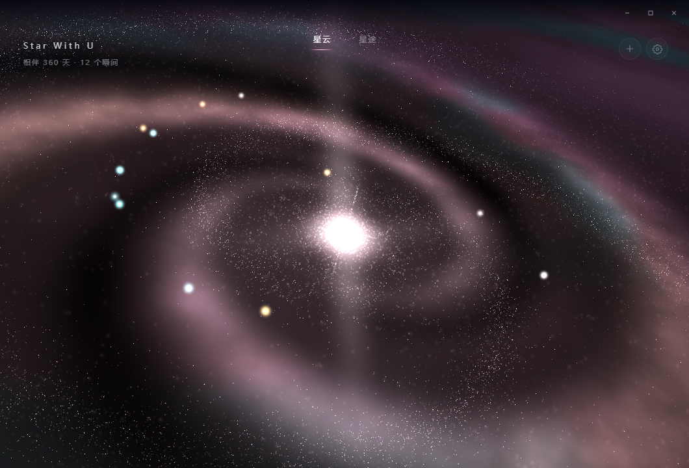
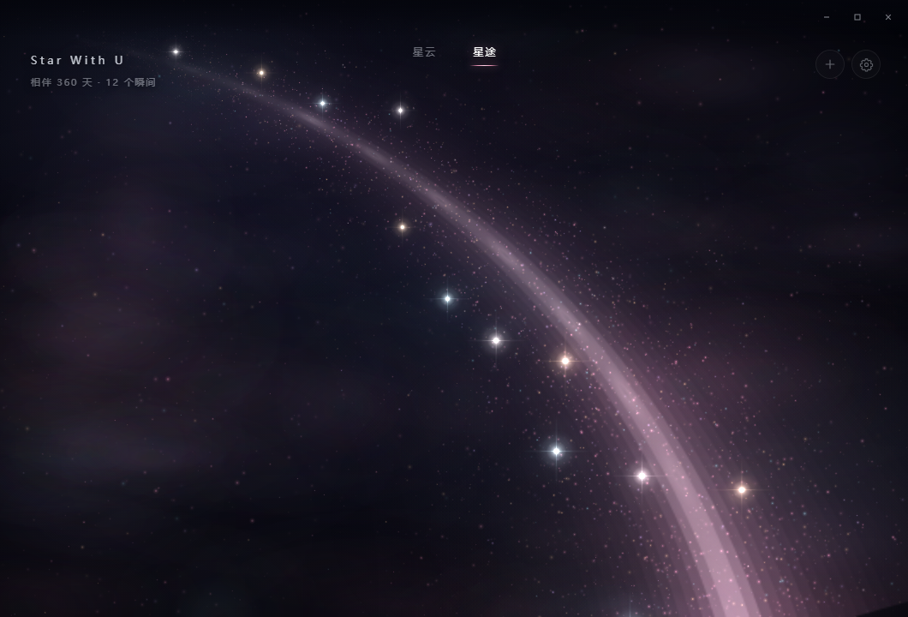
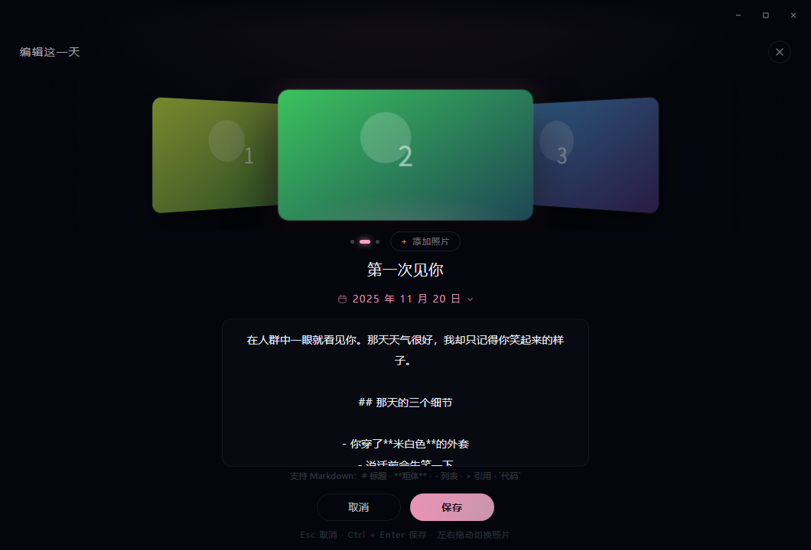
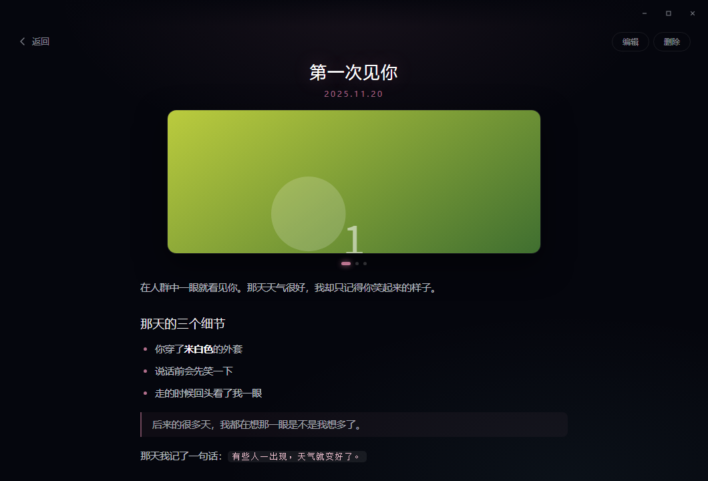
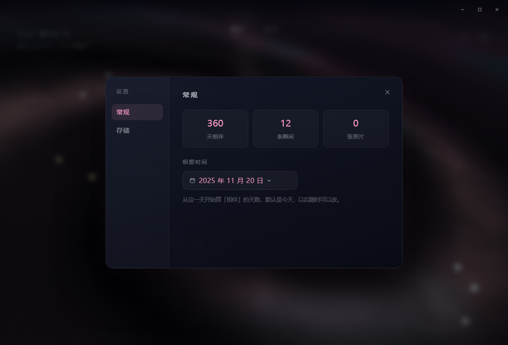

# Star With U

> 把我们的每一天，都挂到星星上。

一个完全离线的**恋爱记录桌面应用**：所有记录都变成星云里的星星，点开就是那一天的照片与文字。
Wails + Go + SQLite 打包成单个 exe，不联网、不注册、不传云端——数据就在你自己的磁盘上。

<p>
  
  
  
  
  
  
</p>



---

## 目录

- [项目特色](#项目特色)
- [界面截图](#界面截图)
- [技术栈](#技术栈)
- [快速开始](#快速开始)
- [目录结构](#目录结构)
- [数据与存储](#数据与存储)
- [几个设计决定](#几个设计决定)
- [调试参数](#调试参数)
- [键盘快捷键](#键盘快捷键)
- [已知限制](#已知限制)
- [License](#license)

---

## 项目特色

**两套主视图，同一批数据**

- **星云**：three.js 绘制的三维星系，约 9.6 万个点精灵分六层叠出来——暖雾、星屑、旋臂相位、核球光晕、带内尘、外圈晕。窗口 1060×720 全画幅铺满，盘面直径做到四角半径的 1.36 倍，转到任何角度都看不到边界。
- **星途**：把同一条记录铺成一条**从左上远方舒展到右下跟前的光之路**。中心线是羊角螺线（Euler spiral），路面不用任何填色与描边，只沿中心线铺一条两端归零的横向剖面——所以整条路没有可以指认的边。
- 顶部「星云 / 星途」是纯文字导航，选中项靠一根淡粉横杠说明；点星云正中的光团也能切到星途。

**事件即星星**

- 每条记录在星系里的位置由它的数据库 `id` 决定（`nebulaPos`，对数螺旋 + 两条旋臂，72% 落在臂上），所以关掉再开、换台机器恢复数据，星星还在原来的地方。
- 悬停出日期与标题的提示，点击进详情。
- 星途里事件按时间先后从远到近排布（`t = 0.17 + 0.77 · i/(n-1)`），并沿法向散落，不会排成一条直线。

**写一天，像摆一张桌子**

- 添加页顶部是 3D CoverFlow 照片墙：中间一张正面，两侧按 `perspective: 950px` 斜切后退，支持滚轮、拖拽、左右方向键。
- 日期是自绘的暗色日历（周一起始、6×7 网格、四个翻页箭头），不是系统原生日历控件。
- 正文支持 Markdown：标题、粗体/斜体/删除线、行内代码与代码块、引用、有序/无序列表、分割线、链接。

**详情页**

- 标题与日期固定在顶部不随正文滚动，图片区自动轮播（3.4 秒，悬停暂停），正文单独滚动。
- Markdown 渲染做了**先转义后生成**：正文里写什么都注入不了脚本，链接只放行 `http(s)` 与 `mailto`。

**数据在你自己手里**

- SQLite 单文件 `star.db` + `images/` 目录，没有服务端、没有账号。
- 数据目录**便携优先**：程序同级 `data/` 可写就用它，不可写退到 `文档\Star With U`，再退 `%AppData%\StarWithU\data`。
- 设置里可以把数据目录整体搬到任意盘符，搬完自动重开数据库；搬完整个文件夹拷走就能换机器。

**桌面感**

- 无边框窗口，自绘标题栏：拖动、双击最大化、最小化、关闭都在；
- 开屏是一段粒子动画：把 logo 拆成上万颗按亮度分布的粒子，聚一下再散开，散开的同时背后的星系开始聚拢。整段 3.5 秒，跳过它按 `?nointro`。

---

## 界面截图

| 星云：三维星系，事件星沿旋臂分布 | 星途：从远方铺到跟前的光之路 |
| --- | --- |
|  |  |

**添加 / 编辑：3D CoverFlow 照片墙 + Markdown 正文 + Ctrl+Enter 保存**



**详情：标题日期固定，图片自动轮播，只有正文滚动**



**设置：常规（相爱天数、事件数、照片数）/ 存储（数据目录与迁移）**



---

## 技术栈

| 层 | 选型 | 用途 |
| --- | --- | --- |
| 桌面壳 | [Wails v2.16](https://wails.io) | WebView2 承载前端，Go 方法直接绑定给 JS |
| 后端 | Go 1.26 | 事件 CRUD、图片导入、设置与配置读写 |
| 数据库 | SQLite（`modernc.org/sqlite`，纯 Go 实现） | 单文件、WAL、免 CGO，交叉编译不用装 gcc |
| 前端 | Vue 3.5 + Vite 7 | 组件与构建 |
| 三维 | three.js 0.187 | 星系点云与解析场平面 |
| 绘图 | Canvas 2D | 星途光带、开屏粒子、事件星精灵 |
| 图片 | `golang.org/x/image` | 统一转码成 JPEG（长边 1600，质量 88） |

---

## 快速开始

### 环境

- Go 1.26+
- Node.js 18+
- [Wails CLI](https://wails.io/docs/gettingstarted/installation)：`go install github.com/wailsapp/wails/v2/cmd/wails@latest`
- Windows 10/11 + WebView2 运行时（Win11 自带）

### 开发

```bash
# 热重载开发（自动开窗口，前端改动即时生效）
wails dev

# 只改前端时，也可以直接跑 Vite —— 没有后端时会自动退化成演示数据
cd frontend && npm install && npm run dev
# 打开 http://localhost:5173/?demo&nointro 即可，不需要 Go 进程
```

### 打包

```bash
# 生成 build/bin/StarWithU.exe 与 NSIS 安装包
wails build -nsis -ldflags "-s -w" -tags prod
```

产物：

| 文件 | 说明 |
| --- | --- |
| `build/bin/StarWithU.exe` | 单文件主程序（约 17 MB） |
| `build/bin/StarWithU-amd64-installer.exe` | NSIS 安装包（约 9 MB） |

`-tags prod` 会关掉 Wails 的调试资源；`-ldflags "-s -w"` 去掉符号表与调试信息。

---

## 目录结构

```
StarWithU/
├── main.go                     # Wails 启动参数：1060×720、无边框、不可缩放
├── app.go                      # 全部后端能力：事件、图片、设置、配置、示例数据
├── internal/
│   ├── store/store.go          # SQLite 封装 + 星云位置计算（nebulaPos）
│   └── media/media.go          # 图片导入：解码 → 缩放 → 转 JPEG → data URL
├── frontend/
│   ├── index.html
│   └── src/
│       ├── App.vue             # 视图调度：星云/星途、详情、编辑、设置、开屏
│       ├── api.js              # 后端绑定的薄封装 + 日期工具
│       ├── markdown.js         # 先转义后生成的轻量 Markdown
│       ├── mock.js             # 浏览器调试用的演示数据
│       └── components/
│           ├── Universe.vue    # three.js 星系
│           ├── StarTrail.vue   # Canvas 光之路
│           ├── DetailView.vue  # 详情
│           ├── EditorView.vue  # 添加/编辑
│           ├── CoverFlow.vue   # 3D 照片墙
│           ├── DatePicker.vue  # 自绘日历
│           ├── SettingsPanel.vue
│           ├── Splash.vue      # 开屏粒子
│           └── TitleBar.vue    # 自绘标题栏
├── build/                      # 图标、NSIS 模板、打包资源
├── tools/genicon/              # 图标生成小工具
└── docs/screenshots/           # README 用截图（浏览器调试模式，演示数据）
```

---

## 数据与存储

### 目录布局

```
<数据目录>/
├── star.db          # SQLite 主库（WAL 模式）
├── star.db-wal      # 事务日志，随库一起搬
├── star.db-shm
├── images/          # 所有照片，统一为 <pid>_<随机>.jpg
└── app.log          # 关键动作日志，超过 256 KB 自动重建
```

配置文件单独放 `%AppData%\StarWithU\config.json`（记录数据目录与相爱开始日期），不随数据目录搬动。

### 表结构

```sql
CREATE TABLE events (
  id          INTEGER PRIMARY KEY AUTOINCREMENT,
  title       TEXT    NOT NULL,
  date        TEXT    NOT NULL,              -- YYYY-MM-DD
  description TEXT    NOT NULL DEFAULT '',    -- Markdown 原文
  images      TEXT    NOT NULL DEFAULT '[]',  -- JSON 数组，存文件名
  x REAL, y REAL, z REAL,                     -- 星云里的单位化坐标
  created_at  TEXT    NOT NULL DEFAULT ''
);
CREATE INDEX idx_events_date ON events(date);
```

`x/y/z` 每次打开数据库时按 `id` 重算一遍（`relayout`），所以位置是可重建的派生数据，不是用户资产。

### 迁移与兼容

- 早期版本叫「噜噜华」，库文件是 `lulu.db`，配置在 `%AppData%\LuluHua\`。启动时若发现旧文件会自动改名接续，数据不会丢。
- 换数据目录 = 关库 → 整目录复制 → 开新库 → 写配置；任一步失败会退回原库，不会留下半个库。

---

## 几个设计决定

**星的坐标由 id 算，不用随机数落库**
`nebulaPos(id)` 用 `id` 派生种子，得到「对数螺旋 + 两条旋臂」上的点：半径 `0.2 + 0.72·u^0.68` 避开最亮的核心，72% 的星星贴旋臂，其余弥散在盘面。这样备份恢复、换机器、删了再建都不会让整片星空重排。

**星途为什么用羊角螺线**
想让一条线「由远及近」，靠手摆控制点永远是猜。羊角螺线的曲率随弧长单调变化，正是公路铁路接直线与圆曲线的缓和曲线：远端曲率趋近 0（像从无限远渗出来），越靠近观者弯得越明显。实现是积分切向角 `θ(u)=6°+68°·u`，再二分路径长度让它从画面右下穿出。

**为什么光带没有边**
凡是「填出来的形状」都有轮廓：填色有硬边，描边有亮线，两种都会被眼睛读成管道。这里整条带切成 78 条并排细带，每条沿整条路一次画完（沿路无拼缝），横截面用两端严格归零的钟形剖面（五层叠加，外藕粉到内近白），半宽按透视律正比于弧长。带子先画在半分辨率离屏画布再放大贴回，重采样把亚像素缝抹平；它不随时间变化，只在 resize 时烘焙一次。

**Markdown 先转义再生成**
先把整段文本 HTML 转义，再生成受控标签，所以正文里写什么都注入不了脚本。链接只放行 `http(s)`/`mailto`。

---

## 调试参数

浏览器里调样式不必等后端：加 `?demo` 用演示数据，`?nointro` 跳过开屏。

| 参数 | 作用 |
| --- | --- |
| `?demo` | 使用 `mock.js` 的演示数据（12 条记录、占位图） |
| `?nointro` | 跳过开屏动画与入场 |
| `?mode=trail` | 直接进入星途 |
| `?view=detail` | 直接打开第一条的详情 |
| `?view=editor&edit=1` | 打开编辑态，`edit=n` 指定第 n 条 |
| `?view=settings` / `?tab=storage` | 打开设置，或直接落到「存储」页 |
| `?ci=n` | 编辑页轮播初始停在第 n 张 |
| `?dpop` | 直接展开日历面板 |
| `?rot=1.2` / `?intro=0.4` | 星系固定旋转角 / 冻结在入场动画某进度 |
| `?th0= &turn= &pow= &hw=` | 临时覆盖星途的切向角、总转角、曲率增速、近端半宽 |

```bash
# 示例：在浏览器里看星途，并把弯调大一点
http://localhost:5173/?demo&nointro&mode=trail&turn=78
```

---

## 键盘快捷键

| 位置 | 按键 | 动作 |
| --- | --- | --- |
| 编辑页 | `Ctrl/⌘ + Enter` | 保存 |
| 编辑页 | `Esc` | 取消并关闭 |
| 详情页 | `Esc` | 返回星云 |
| 详情页 | `←` / `→` | 上一张 / 下一张照片 |

---

## 已知限制

- 目前只验证 Windows 打包（`-nsis`）。Wails 本身跨平台，但 `OpenDataDir` 用的是 `explorer`，其他平台要改。
- 窗口固定 1060×720，不允许缩放（设计如此）。
- 没有导出/备份按钮，备份方式就是拷走整个数据目录。
- 没有搜索、标签、时间轴筛选——数据显示在几何图形上，不做列表。
- README 里的截图来自浏览器调试模式（`?demo&nointro`），用的是占位色块而不是真实照片；开屏粒子动画是运行时逐帧画的，headless 截图抓不到稳定静帧，所以没有放进来。

---

## License

[MIT](LICENSE) © 2026 emo熊
